# Autonomous AI Cloud Red-Team & Chaos Adversary Engine

[](https://github.com/KoshaG0hil/Autonomous-AI-Cloud-RedTeam-Chaos-Agent/actions)
[](https://opensource.org/licenses/MIT)
[](https://www.python.org/downloads/)
[](https://attack.mitre.org/matrices/enterprise/cloud/)
[](https://www.terraform.io/)

> **Next-Generation Cloud Adversary Emulation & Breach Simulation (BAS):** An autonomous AI-driven red-teaming engine that synthesizes multi-hop cloud attack graphs, discovers hidden lateral movement paths, calculates blast radius metrics, and auto-generates self-healing Terraform code.

---

## 🚀 Key Highlights & Architectural Innovation

1. **Autonomous ReAct Reasoning Loop:** Unlike passive vulnerability scanners (Prowler, ScoutSuite) that produce disconnected finding lists, this agent chains misconfigurations into **multi-hop attack vectors** (e.g., *Public Ingress $\rightarrow$ IMDSv1 SSRF $\rightarrow$ Instance Profile STS Elevation $\rightarrow$ S3 Backup Leak $\rightarrow$ Root Admin Takeover*).
2. **NetworkX Directed Attack Graphs:** Models complex cloud topologies as weighted directed graphs to identify the **shortest path of resistance** to crown jewel assets.
3. **Architectural Chokepoint Discovery:** Identifies articulation points where severing a single IAM trust or network route eliminates multiple downstream attack vectors.
4. **MITRE ATT&CK for Cloud Matrix Alignment:** Directly maps every hop to real-world cloud adversary techniques (`T1078.004`, `T1552.005`, `T1530`, `T1098.001`, `T1548.005`).
5. **Self-Healing Infrastructure-as-Code:** Automatically synthesizes production-ready Terraform HCL patches to close attack vectors without manual intervention.

---

## 🏗️ Attack Path Flowchart

```mermaid
flowchart LR
    A["Public Internet Ingress\n(0.0.0.0/0)"] -->|"T1078: Public Exposure"| B["Edge Bastion EC2\n(IMDSv1 Vulnerable)"]
    B -->|"T1552.005: SSRF Token Theft"| C["AppDeployment Role\n(Over-permissive STS)"]
    C -->|"T1530: S3 Extraction"| D["corporate-db-backups\n(Unencrypted S3)"]
    D -->|"T1098.001: Wildcard Admin"| E["Crown Jewel:\nIAM Admin / Root Access"]:::critical

    classDef critical fill:#ff4d4f,stroke:#fff,stroke-width:2px,color:#fff;
```



---

## 📊 Quantitative Blast Radius Metrics

The engine calculates an objective **Blast Radius Severity Index ($0 - 100$)**:

$$\text{Blast Radius Index} = \text{Base} + \max(0, (10 - \text{Hops}) \times 3.5) + (\text{Reachability \%} \times 0.25)$$

* **Target Exposed:** `YES (Crown Jewel Compromised)`
* **Shortest Vector:** `4 Hops`
* **Reachability:** `25.0% of all cloud assets`
* **Blast Radius Score:** `87.2 / 100 [CRITICAL]`

---

## ⚡ Quick Start & CLI Demo

### Prerequisites
* Python 3.11+
* Git

```bash
# Clone the repository
git clone https://github.com/KoshaG0hil/Autonomous-AI-Cloud-RedTeam-Chaos-Agent.git
cd Autonomous-AI-Cloud-RedTeam-Chaos-Agent

# Install dependencies
pip install -r requirements.txt

# Run the interactive autonomous simulation CLI
python cli.py

# Run automated test suite
pytest tests/ -v
```

---

## 🛡️ Sample Auto-Generated Terraform Patch

When the agent discovers that an EC2 instance is vulnerable to IMDSv1 credential theft via SSRF (`T1552.005`), it autonomously synthesizes the following patch:

```hcl
# Auto-generated Remediation: Enforce IMDSv2
resource "aws_instance" "EC2_Edge_Bastion" {
  metadata_options {
    http_endpoint               = "enabled"
    http_tokens                 = "required"  # Enforces IMDSv2 session tokens
    http_put_response_hop_limit = 1
  }
}
```

---

## 🧪 Automated Test Suite (100% Passing)

```bash
$ pytest tests/ -v
tests/test_redteam.py::test_mitre_mapper PASSED                          [ 20%]
tests/test_redteam.py::test_attack_graph_pathfinding PASSED              [ 40%]
tests/test_redteam.py::test_blast_radius_calculator PASSED               [ 60%]
tests/test_redteam.py::test_self_healing_engine PASSED                   [ 80%]
tests/test_redteam.py::test_autonomous_red_team_agent_end_to_end PASSED  [100%]

============================== 5 passed in 1.17s ==============================
```

---

## 📄 License
This project is open-source under the [MIT License](LICENSE).
